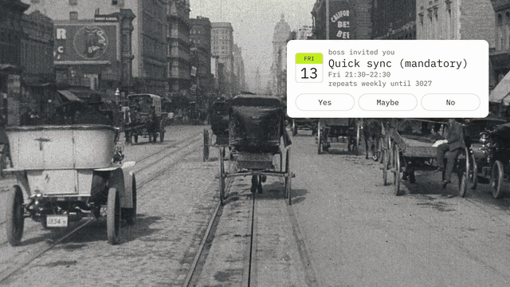

<p align="center">
  
</p>

<h1 align="center">bossdetox.ing</h1>

<p align="center"><strong>Toxic boss? Keep your soul. Keep your paycheck.</strong></p>

<p align="center">
  A free pocket ward for toxic-boss days. Name what your boss is doing, get a calm line to say and a reply to send in writing, keep receipts, and pull a tarot card while you're at it.<br />
  Works offline. Tells no one. No accounts, no AI, no ads, no tracking.
</p>

<p align="center">
  <a href="https://ass.bossdetox.ing"><strong>Open the app</strong></a> ·
  <a href="https://chromewebstore.google.com/detail/bossdetoxing/kimmdnobgafbdcjnnaadphlbgacflffi"><strong>Add to Chrome</strong></a> ·
  <a href="https://youtu.be/F17ikeZEf1A">Watch the film</a> ·
  <a href="https://bossdetox.ing">Website</a>
</p>

<p align="center">
  <a href="https://youtu.be/F17ikeZEf1A"></a><br />
  <sub>Moments from <em>Per my last exorcism</em>, our 54-second film. <a href="https://youtu.be/F17ikeZEf1A">Watch it with sound</a>.</sub>
</p>

## What's inside

- **Name the threat.** Twenty classics, from the moving goalpost to the meeting about the meeting. Tap one and get a line to say out loud and a line to write in the email.
- **Pick your rock.** Yellow Rock is warm. Grey Rock is boring on purpose. Firm Rock says no, politely.
- **Your boss's signature move.** Every boss has a move only they pull. Name it in the Bestiary, write your comeback, and it joins the grid.
- **Pull a card.** One card a day from a 78-card corporate deck: famous paintings turned stickers, each with a mantra and one next step for the actual job.
- **Your boss's horoscope.** The real moon, Mercury and planets, calculated on your device. The boss forecast is for fun. Get it in writing anyway.
- **The Grimoire keeps receipts.** A private calendar of what happened and when, locked with your passphrase. One tap on the eye hides everything.
- **Hide in plain sight.** Give the tab or toolbar icon a boring disguise: mail, a calendar, a chart, a plain search box.

## Install

You have two options. Pick one, or use both.

### Option 1: the app (phone or computer, nothing to install)

1. Open **[ass.bossdetox.ing](https://ass.bossdetox.ing)** in your browser.
2. That's it. After the first visit it works offline too.
3. Optional, for an icon on your home screen:
   - **iPhone (Safari):** tap the Share button, then **Add to Home Screen**.
   - **Android (Chrome):** tap the ⋮ menu, then **Add to Home screen** or **Install app**.
   - **Computer (Chrome or Edge):** click the install icon at the right end of the address bar.

### Option 2: the browser extension (opens in a side panel next to your work)

Get it from the **[Chrome Web Store](https://chromewebstore.google.com/detail/bossdetoxing/kimmdnobgafbdcjnnaadphlbgacflffi)**. It needs Google Chrome 116 or newer, and also installs in browsers that use the Chrome Web Store, such as Edge and Vivaldi.

1. **Add it.** Open the [store listing](https://chromewebstore.google.com/detail/bossdetoxing/kimmdnobgafbdcjnnaadphlbgacflffi) and click **Add to Chrome**.
2. **Pin it.** Click the puzzle-piece icon in the toolbar and click the pin next to **bossdetox.ing**. Its toolbar icon is a plain magnifying glass, on purpose.
3. **Open it.** Click the magnifying glass, or press **Alt+Shift+O** (**Option+Shift+O** on a Mac). The side panel opens. Browsers without a side panel open it as a small window under the icon instead.

Updates arrive on their own from the store, and your encrypted history stays.

**Add to Chrome is greyed out or blocked?** Your company manages this browser profile. Use the app from Option 1 instead, on your own phone.

<details>
<summary>Manual install from the release ZIP (developer mode)</summary>

1. Download **`bossdetox-ing-<version>-chrome.zip`** from the [latest release](https://github.com/bossdetox-ing/bossdetoxing/releases/latest) and unzip it somewhere you won't tidy away.
2. Open `chrome://extensions`, switch on **Developer mode** and click **Load unpacked**.
3. Choose the unzipped folder that has `manifest.json` directly inside it.

To update, replace the folder's contents with the new ZIP's files and click ↻ on the extension's card. Keep the same folder: a different folder is a new install with empty history.

</details>

## Privacy, in plain words

- The extension makes zero network requests. The app only downloads itself and its updates. Nothing you tap or type is sent anywhere.
- History is optional, encrypted with your passphrase and stored only in your browser. No account, no cloud, no recovery: lose the passphrase, lose the history.
- **The limits are real.** A work laptop, monitoring software, screen sharing, screenshots or clipboard history can still show what's on your screen. The eye button hides everything in one tap, but nothing makes you invisible on a managed device.

**This is a coping tool for a bad day at work, not therapy or legal advice.** If you're dealing with threats, harassment or danger, go to [Support without jokes](https://bossdetox.ing/support/).

## For developers

The extension (WXT, Chrome MV3), the PWA (`pwa/`, Vite) and the shared React app (`src/`) live in this repo. Use Node **22.23.4 or later**.

```sh
npm ci
npm run dev          # extension dev build (development only)
npm test             # unit tests
npm run test:e2e     # typecheck, production build, privacy audit, extension browser tests
npm run package      # loadable ZIP in release/ with SHA-256 checksums
```

### Firefox build (for add-on reviewers)

Built on macOS (arm64) with Node 22.23.4 and npm 11.6.2; any OS with Node 22.23.4+ works. No other tools are needed.

```sh
npm ci
npm run build:firefox   # output: .output/firefox-mv3, identical to the submitted add-on
```

`npm run package:firefox` also zips the add-on and this source into `release/`.

Run `npx playwright install chromium` once before the browser tests. Build the PWA into `pwa/dist` with:

```sh
npm run build:web
```

| Area                                                      | Location                        |
| --------------------------------------------------------- | ------------------------------- |
| Browser action, service worker, MV3 policy                | `entrypoints/`, `wxt.config.ts` |
| Screens and components                                    | `src/app/`, `src/components/`   |
| Deterministic selection, content contracts, session logic | `src/domain/`                   |
| Copy, mantras, tarot and threats                          | `src/content/`                  |
| PBKDF2/AES-GCM vault, encrypted archives                  | `src/vault/`                    |
| Tokens and styles                                         | `src/styles/`                   |
| Tests                                                     | `tests/`                        |

## License

Code is [MIT](LICENSE). Tarot art comes from public-domain paintings via Wikimedia Commons; fonts and other third-party pieces keep their own licences, listed in `THIRD_PARTY_NOTICES.txt` inside every build.
